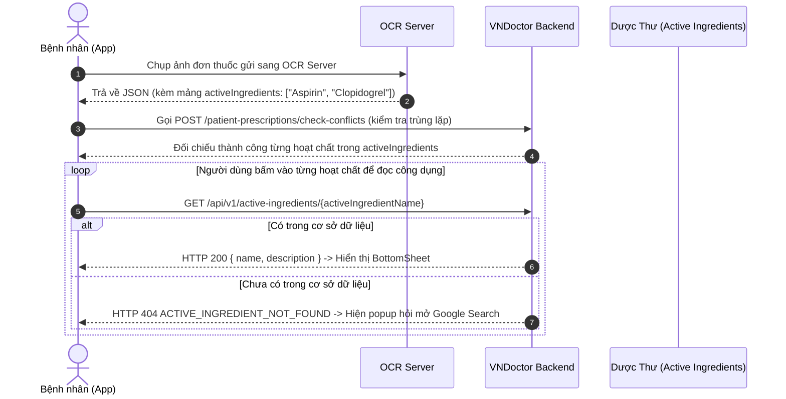

# 📋 Quy Chuẩn Kỹ Thuật: Cấu Trúc Dữ Liệu Đầu Ra (OCR Response) Cho Đơn Thuốc Y Tế

> **Tài liệu dành cho**: Đội ngũ phát triển **OCR Server / AI Document Intelligence** và **Backend VNDoctor**.  
> **Mục tiêu**: Chuẩn hóa định dạng JSON phản hồi từ OCR Server khi phân tích ảnh/PDF đơn thuốc, tối ưu hóa cho chức năng **Tra cứu hoạt chất Dược thư** và **Kiểm tra trùng lặp, tương tác thuốc tự động**.

---

## 🎯 1. Lý Do Cần Cập Nhật Cấu Trúc OCR

Trước đây, trường hoạt chất chỉ được trả về dưới dạng một chuỗi đơn lẻ (`activeIngredient: string`). Định dạng này gây ra 2 hạn chế lớn trong nghiệp vụ y tế:

1. **Thuốc phối hợp nhiều hoạt chất (Combined Medications)**:
   - *Ví dụ*: Thuốc `Clopiaspirin 75/100` gồm 2 hoạt chất: **Aspirin** và **Clopidogrel**.
   - Nếu OCR chỉ trả về chuỗi gộp `"Acetylsalicylic acid + clopidogrel"`, hệ thống Backend và Mobile App không thể tra cứu được trong Dược thư (vì Dược thư lưu từng hoạt chất độc lập), dẫn đến việc luôn bị coi là "Chưa có trong từ điển" và phải chuyển hướng sang Google.
2. **Tên hoạt chất bị dính hàm lượng, tỷ lệ hoặc mô tả phụ**:
   - *Ví dụ*: `"Insulin người tái tổ hợp (30% insulin hòa tan & 70% insulin isophan)"`.
   - Chuỗi này dính phần trăm và phụ chú trong ngoặc đơn, khiến thuật toán tìm kiếm chính xác theo danh pháp hoạt chất bị sai lệch.

👉 **Giải pháp cập nhật**:
- **Giữ nguyên `activeIngredient` (`string`)**: Chuỗi nguyên văn hiển thị trên đơn để lưu vào hồ sơ bệnh án cho bác sĩ đọc.
- **Bổ sung `activeIngredients` (`string[]`)**: Mảng chứa danh sách các hoạt chất đã được **tách riêng** và **làm sạch tên danh pháp quốc tế (INN / Generic name)** để phục vụ tra cứu từ điển và kiểm tra tương tác.

---

## 📐 2. Cấu Trúc JSON Phản Hồi Mẫu (Response Specification)

### 2.1. Cấu trúc tổng thể
```json
{
  "status": "success",
  "total_medications": 2,
  "drug_names": [
    "SCILIN M30 (30/70)",
    "Clopiaspirin 75/100"
  ],
  "prescription_info": {
    "patient_name": "NGUYEN THI CO",
    "age": "70",
    "gender": "Nữ",
    "diagnosis": "Nhồi máu não khác / THA - ĐTĐ tuyp 2",
    "doctor_name": "ThS.BS Phạm Thị Thúy",
    "facility_name": "BỆNH VIỆN ĐA KHOA TỈNH PHÚ THỌ",
    "date": "26/10/2026"
  },
  "medications": [
    {
      "order": 1,
      "drugName": "SCILIN M30 (30/70)",
      "activeIngredient": "Insulin người tái tổ hợp (30% insulin hòa tan & 70% insulin isophan)",
      "activeIngredients": [
        "Insulin người",
        "Insulin isophan"
      ],
      "strength": "100 IU/ml - 10ml",
      "unit": "lọ",
      "quantity": 1,
      "route": "Tiêm dưới da",
      "instructions": "Tiêm dưới da trước ăn 30 phút, bơm tiêm chia vạch 50UI/ 0,5 ml, nắp cam",
      "timing": "Sáng 12 đơn vị; tối 12 đơn vị"
    },
    {
      "order": 2,
      "drugName": "Clopiaspirin 75/100",
      "activeIngredient": "Acetylsalicylic acid + clopidogrel",
      "activeIngredients": [
        "Acetylsalicylic acid",
        "Clopidogrel"
      ],
      "strength": "100mg + 75mg",
      "unit": "viên",
      "quantity": 30,
      "route": "Uống",
      "instructions": "Uống sau ăn no",
      "timing": "Ngày 1 viên buổi sáng"
    }
  ]
}
```

---

## 🔍 3. Bảng Chi Tiết Thuộc Tính Trong Mảng `medications`

| Tên thuộc tính | Kiểu dữ liệu | Bắt buộc | Mô tả & Quy chuẩn | Ví dụ |
| :--- | :---: | :---: | :--- | :--- |
| `order` | `number` | Có | Số thứ tự thuốc trong đơn (bắt đầu từ 1). | `1`, `2` |
| `drugName` | `string` | Có | Tên thuốc thương mại / Biệt dược in trên đơn. | `"Clopiaspirin 75/100"` |
| **`activeIngredient`** | `string` \| `null` | Không | Chuỗi mô tả hoạt chất nguyên văn (phục vụ hiển thị đơn). | `"Acetylsalicylic acid + clopidogrel"` |
| **`activeIngredients`** | `string[]` | **Có (Khuyên dùng)** | **Mảng danh sách các hoạt chất đã tách riêng và làm sạch danh pháp gốc để tra cứu Dược thư**. | `["Acetylsalicylic acid", "Clopidogrel"]` |
| `strength` | `string` \| `null` | Không | Hàm lượng hoạt chất của thuốc. | `"100mg + 75mg"`, `"5mg"`, `"100 IU/ml"` |
| `unit` | `string` \| `null` | Không | Đơn vị tính (viên, lọ, ống, gói, chai...). | `"viên"`, `"lọ"`, `"ống"` |
| `quantity` | `number` \| `null` | Không | Số lượng cấp phát dạng số nguyên. | `30`, `1` |
| `route` | `string` \| `null` | Không | Đường dùng thuốc (Uống, Tiêm dưới da, Đặt dưới lưỡi, Bôi ngoài da...). | `"Uống"`, `"Tiêm dưới da"` |
| `instructions` | `string` \| `null` | Không | Hướng dẫn cách dùng chi tiết (trước/sau ăn, cách pha...). | `"Uống sau ăn no"` |
| `timing` | `string` \| `null` | Không | Thời điểm và liều dùng trong ngày (Sáng/Trưa/Chiều/Tối). | `"Ngày 1 viên buổi sáng"` |

---

## 🛠️ 4. Quy Tắc Bóc Tách & Chuẩn Hóa Hoạt Chất (`activeIngredients`)

Đội ngũ phát triển OCR Server cần áp dụng các quy tắc sau khi trích xuất mảng `activeIngredients`:

### Quy tắc 1: Tách các thuốc phối hợp (Multi-ingredient drugs)
Khi chuỗi hoạt chất có các ký tự ngăn cách như dấu cộng `+`, dấu gạch chéo `/`, chữ `và`, `&`, `phối hợp với`:
- *Đơn thuốc ghi*: `Amlodipin 5mg + Atorvastatin 10mg` hoặc `Amlodipin / Atorvastatin`
- 👉 `activeIngredient`: `"Amlodipin 5mg + Atorvastatin 10mg"`
- 👉 `activeIngredients`: `["Amlodipin", "Atorvastatin"]`

### Quy tắc 2: Tách bỏ hàm lượng và đơn vị đo
Tên hoạt chất trong `activeIngredients` **không được dính số lượng hoặc đơn vị** (`mg`, `mcg`, `g`, `ml`, `UI`, `%`):
- *Đơn thuốc ghi*: `Paracetamol 500mg`
- 👉 `activeIngredients`: `["Paracetamol"]`

### Quy tắc 3: Làm sạch ghi chú trong ngoặc đơn
Loại bỏ phần giải thích tỷ lệ hoặc mô tả phụ trong dấu ngoặc `(...)`:
- *Đơn thuốc ghi*: `Insulin người tái tổ hợp (30% insulin hòa tan & 70% insulin isophan)`
- 👉 `activeIngredients`: `["Insulin người", "Insulin isophan"]`

### Quy tắc 4: Chuẩn hóa chữ hoa đầu từ (Capitalize)
- Tên hoạt chất viết hoa chữ cái đầu, các chữ sau viết thường, cắt bỏ khoảng trắng thừa hai đầu (Trim):
- *Đơn thuốc ghi*: `clopidogrel bisulfate` $\rightarrow$ `activeIngredients`: `["Clopidogrel"]` (hoặc `["Clopidogrel bisulfate"]`).

---

## 🤖 5. Prompt Mẫu Cho LLM / Vision AI Trên OCR Server

Nếu OCR Server sử dụng mô hình AI (như Gemini 1.5 Pro/Flash, GPT-4o, Claude 3.5 Sonnet) để trích xuất JSON từ hình ảnh đơn thuốc, có thể bổ sung đoạn Prompt sau vào `system_instruction` hoặc `prompt` trích xuất:

```markdown
Về trường thuốc (medications), hãy đảm bảo cấu trúc mỗi item gồm:
- "drugName": Tên thương mại/biệt dược của thuốc in trên đơn.
- "activeIngredient": Chuỗi nguyên văn mô tả hoạt chất (nếu có ghi trên đơn).
- "activeIngredients": MẢNG DANH SÁCH (array of strings) các hoạt chất y khoa cấu thành nên thuốc đó.
  * Nếu là thuốc đơn chất: Trả về mảng 1 phần tử đã làm sạch hàm lượng (Ví dụ: "Paracetamol 500mg" -> ["Paracetamol"]).
  * Nếu là thuốc phối hợp có dấu "+", "/", "và": Tách riêng từng hoạt chất thành từng phần tử độc lập (Ví dụ: "Acetylsalicylic acid + clopidogrel" -> ["Acetylsalicylic acid", "Clopidogrel"]).
  * Loại bỏ các phần trăm, tỷ lệ và ghi chú trong ngoặc đơn khỏi tên hoạt chất.
- "strength": Hàm lượng (ví dụ: "5mg", "100mg + 75mg").
- "unit": Đơn vị tính (viên, lọ, gói, ống...).
- "quantity": Số lượng dạng số (ví dụ: 30).
- "route": Đường dùng (Uống, Tiêm dưới da, Đặt dưới lưỡi...).
- "instructions": Hướng dẫn sử dụng (Ví dụ: "Uống sau ăn no").
- "timing": Thời điểm dùng (Ví dụ: "Sáng 1 viên, tối 1 viên").
```

---

## 🔗 6. Kết Nối Luồng Nghiệp Vụ Với VNDoctor Backend & App



Tài liệu này là căn cứ chuẩn để đội ngũ phát triển OCR Server cập nhật mã nguồn, đảm bảo toàn bộ hệ thống từ OCR $\rightarrow$ Backend $\rightarrow$ Mobile App vận hành liền mạch, chính xác.

